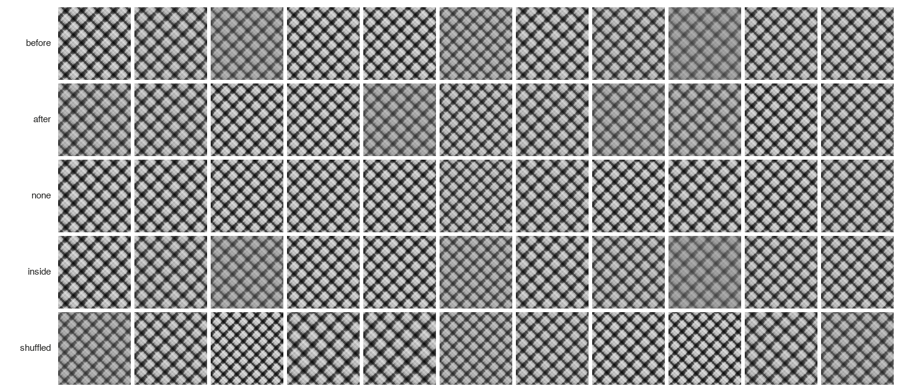
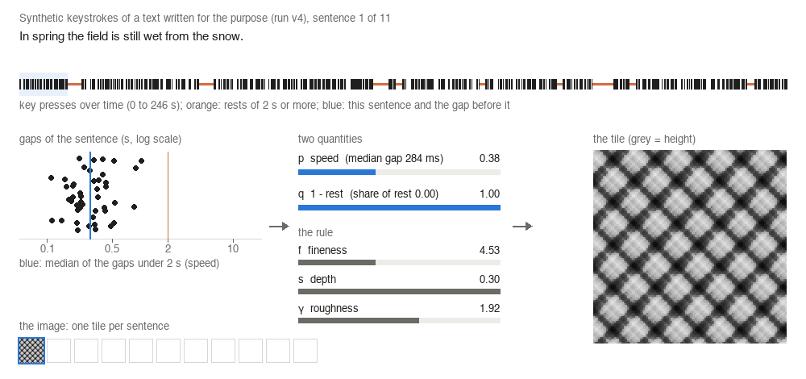
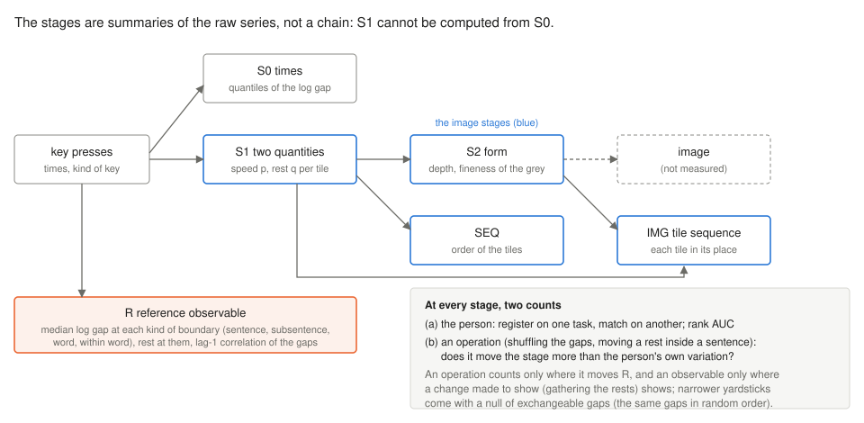

<h1 align="center">KeepCount</h1>

<p align="center">
  行動のデータから作った画像が何を保つかを段ごとに数える監査の、条件・コード・記録・git の履歴。<br>
  打鍵のタイルを作例とする。
</p>

<p align="center">
  <a href="LICENSE"></a>
  <a href="LICENSE-docs"></a>
  
  <a href="https://docs.astral.sh/uv/"></a>
  
  <a href="https://doi.org/10.5281/zenodo.23858735"></a>
</p>

<p align="center"><a href="README.md">English</a> | <b>日本語</b></p>

このリポジトリは論文 *KeepCount: A Stage-by-Stage Audit of What Images of Behavioral Data Keep, with Keystroke Tiles as a Worked Example*（Mikoto Miura・Yuusuke Harada、2026 年 11 月に *Information Visualization* に投稿、査読中。査読前のプレプリント [10.5281/zenodo.23858734](https://doi.org/10.5281/zenodo.23858734)）のアーカイブである。

KeepCount は監査の手順である。データから画像への変換を段に切り、段ごとに、数える前に決めた比べの相手に対して、(a) その段が人をどれだけ見分けるか、(b) データへの操作がその段に映るかを数える。陽性対照を置き、人自身の揺れより細かい物差しには、間を入れ替えても同じとみなせる帰無（同じ間を無作為な順に並べたもの）を添える。作例は、打鍵の時刻を速さと休みの 2 つの量を通して、1 文 1 枚の陰影のタイルに変える変換である。

<p align="center">
  
</p>
<p align="center"><sub>この目的のために書いた 1 つの文章の合成の打鍵（run v4、論文の図 3）。1 文 1 枚のタイルを、文の前の間をその文に数える（<b>before</b>）、前の文に数える（<b>after</b>）、どれにも数えない（<b>none</b>）、休みを同じ文の中へ動かす（<b>inside</b>）、すべての間を並べ替える（<b>shuffled</b>）で描いた。<i>before</i> と <i>inside</i> は同じである。タイルは間の順を持たないからである。この README のどこにも人の記録は載せていない。</sub></p>

## 打鍵がタイルになるまで

<p align="center">
  
</p>

1 つの文について、速さ *p* は 2 秒より短い間の中央値を、速い打ち手と遅い打ち手の平均の間隔のあいだに対数で置いたもの、休み *q* は 2 秒以上の間に費やした時間の割合を 1 から引いたものである。感情から触覚のレリーフへの対応から形を借りた規則が、*p* と *q* からノイズの場の細かさ *f*・深さ *s*・粗さ γ を決め、場を灰色で描く。アニメーションは上の図と同じ文章の 11 文を v4 の系列でたどる。作るツール `tools/readme_media.py` は v4 の関数でタイルを作り直し、*p*・*q*・速さ・休みの割合とすべての画素が v4 の記録と図に一致しなければ止まる。アニメーションはその後で各コマを 128 色に減らしている。説明のための図であり、論文の数はここから取っていない。

<p align="center">
  
</p>

監査した段（論文の図 1）。どの段も記録の部分ごとの元の系列の要約なので、段のあいだの差には、失われたものと、距離が特徴をどう重みづけるかの違いが混ざる。参照の観測量 R は、各間がどの種類の境界の前にあるかを読む。画像の段はこれを読まない。操作で画像を判定するのは、その操作が R を動かす場合に限る。

## 論文の図と表の出どころ

計算はすべて、スクリプトを初めて走らせる前に git にコミットした条件の上で行った。各記録には、条件・スクリプト・入力の SHA-256 と git のコミットが入っている。run `vX` の条件は `works/conditions/prototype_vX.json`、スクリプトは `works/prototype_vX.py`（`works/_common.py` と `src/keystroke.py` を使う）、記録とノートは `results/prototype_vX/` にある。

| 論文 | run |
|---|---|
| 図 1（段） | 3 節から手で描いた図。数は無い |
| 図 2（操作、すべてのセル） | v6b・v6e。手順 4 で読めるセルかは v6f |
| 図 3（合成のアトラス） | v4（`results/prototype_v4/seasons_sentence_external_f42.png`） |
| 表 1（人） | v6・v6c・v6i・v6j |
| 表 2（操作） | v6b・v6d・v6e |
| 表 3（タイルの列） | v6f・v6g・v6h |
| 表 4（記録と、その入れ替えた間の系列との比べ） | v6i・v6j |

run の順と、条件と記録のコミット。論文（補足 A）が名指すものと、この履歴でのものを並べる。

| run | 位置づけ | 問うたこと | 論文: 条件・記録 | ここ: 条件・記録 |
|---|---|---|---|---|
| v1 | b | 4 つの文章の合成の打鍵、30 秒の窓 | c22cd74, 2d033fd | 同じ |
| v2 | b | 10 秒の窓。文章の間に合わせた打鍵の型 | 5502d13, 80adbc2 | 同じ |
| v3 | b | 1 文 1 枚 | acd4f6c, 173753c | 同じ |
| v4 | b | アトラス: 休みの場所、文の前の間の数え方、場の種 | 4cc995d, 7afc35b | 同じ |
| v5 | b | v4 のタイルを深さと細かさで | 8fe045c, 6fd5d61 | 同じ |
| v6 | p | 人のデータでの最初の数え: 人と 3 つの操作（KUPA、136M Keystrokes） | 06b46c2, e3a7fc3 | 06b46c2, 2296b67 |
| v6b | c | 2 つ目の分け方と参照の R。KUPA の新しい 200 人で確かめた | 8bec59a, 071087b | e62dd13, afcfbbc |
| v6c | d | rank-1・rank-20・EER。人数への依存 | c0927ce, e436f43 | d5c5446, bc63d93 |
| v6d | d | R を位置と lag-1 に分ける | 1b70dbe, 17a3ddc | ac659e1, 241abae |
| v6e | c | v6b と v6d を 2 つ目のデータ（LWP）で。確かめの規則は KUPA から先に決めた | cbffc5d, 8d38d89 | aabe8ee, 6efd81e |
| v6f | d | タイルの列と、画像の段の陽性対照 | 3ef9868, 2abf5af | cb787a6, 72d0ed0 |
| v6g | d | 細かい物差し: タイルを自分の間から引き直す | 652ad2e, be5f062 | 1fd4441, 34a3a39 |
| v6h | d | v6g の物差しのための、入れ替えた間の帰無 | 713cdf7, fabcdae | 084006e, 442365a |
| v6i | d | 各記録を自分の入れ替えた系列と比べる。画像に近い段での見分け | 94ceb8c, 3f1202d | 1bc3a87, 70089ac |
| v6j | d | ゆっくりした流れの下の陽性対照。タイルを無作為な順にした DTW。登録側の尺度 | d46e4b4, ab5ab80 | 3605277, 796727a |

位置づけは論文と同じである: **p** 事前に指定、**c** 確かめ、**d** 同じ人での分解、**b** 作りから決まる。v1〜v5 は合成の打鍵だけを使い、`works/texts/` の文章（著者が書いたもの）から作った。v6〜v6j は公開されている 3 つの打鍵のデータを数える。記録にあるのは人をまたぐ数と要約（要約の最小と最大は 1 人の値）で、人の ID は数と SHA-256 だけである。条件・ノート・コミットのメッセージにある `.steering/` は作業のノートを指し、アーカイブには入れていない。

## このアーカイブに入れていないものと理由

| 入れていないもの | 理由 | 代わりにここにあるもの |
|---|---|---|
| 打鍵のデータ（KUPA-KEYS、136M Keystrokes、LWP） | それぞれの条件のもとで入手元に置かれている | v6 と v6e の条件にある入手元・パス・SHA-256（下の「再現」） |
| run v6 の図 6 枚（`results/prototype_v6/{kupa_copy,kupa_essay,aalto_session}_{tiles,scatter}.png`） | 1 人ずつの記録を描いている。論文は人をまたぐ数と要約だけを公開する | `results/prototype_v6/record.json` にある SHA-256。すべてのコミットから除いた（下の「履歴と来歴」） |
| 原稿・補足と、その数・表・図 2 と図 3 を書くスクリプト | 論文の側に置いている。読むのはここにある記録だけである | プレプリントと補足（[10.5281/zenodo.23858734](https://doi.org/10.5281/zenodo.23858734)） |
| 作業のノート（`advice/`・`handoff/`・`.steering/`） | 作業の記録で、計算の入力ではない | スクリプトを走らせるのには要らない |

## 再現

必要なものは [uv](https://docs.astral.sh/uv/) と git である。テストと実行はすべて Apple silicon の macOS で行った。生成器 `atact` は公開リポジトリから固定したコミットで入る（`pyproject.toml`。保管先 [10.5281/zenodo.23681773](https://doi.org/10.5281/zenodo.23681773)）。

```bash
uv sync --frozen                                 # Python 3.13 と uv.lock の固定版
uv run --frozen pytest                           # 189 テストが通る
uv run --frozen python tools/readme_media.py     # この README の画像。v4 の記録と照合する
```

v1〜v5 はほかに何も要らない。run は結果を上書きせず、条件・コード・入力が最後のコミットと同じかを確かめるので、手元のブランチで結果を退けてから走らせる。

```bash
git switch -c rerun
git mv results/prototype_v4 results/prototype_v4.archived && git commit -m "move v4 aside"
uv run --frozen python works/prototype_v4.py
```

（`tools/readme_media.py` は `results/prototype_v4/` を読むので、このブランチでは走らない。）

この版で v4 をこうして走らせ直すと、記録は来歴（コミットと、後の run が関数を足した `src/keystroke.py` の SHA-256）を除いて同じになり、図はバイト単位で同じになった（Apple silicon の macOS）。

v6〜v6j は、条件に書いたパスの打鍵のデータを読み、ファイルの SHA-256 が違えば止まる。

| データ | 入手元 | 条件 | パス |
|---|---|---|---|
| KUPA-KEYS（Velentzas ほか、LREC-COLING 2024） | https://huggingface.co/datasets/ALTACambridge/KUPA-KEYS | CC BY-NC-SA 4.0 | `external/kupa-keys/KUPA-KEYS-TASK-1.csv`、`KUPA-KEYS-TASK-2.csv` |
| 136M Keystrokes（Dhakal ほか、CHI 2018） | http://userinterfaces.aalto.fi/136Mkeystrokes | 非営利・著者の表示 | `external/aalto-136m/Keystrokes.zip` |
| Linking Writing Processes to Writing Quality（Kaggle、2023） | https://www.kaggle.com/competitions/linking-writing-processes-to-writing-quality | コンペティションの規則 | `external/kaggle-lwp/data/train_logs.csv` |

## 履歴と来歴

この履歴は、計算を行った作業用のリポジトリから、run v6 の図 6 枚をすべてのコミットから除いて作った。日付・順序・メッセージ・作者は変えていない。そのため、除いた最初の図より後のコミットは、論文と記録が名指すものと違う。`commit-map.tsv` が元のコミットとここのコミットを対応させる。対応表の最後のコミットより後は、README・使用許諾・対応表を足すコミット（版 1.0.0）と、版 1.0.1 でこの README の画像・それを作るツール・日本語の README・`CITATION.cff` を足すコミットである。

版: 1.0.0（[10.5281/zenodo.23858736](https://doi.org/10.5281/zenodo.23858736)。論文が引く版）、1.0.1（[10.5281/zenodo.23862942](https://doi.org/10.5281/zenodo.23862942)。README の画像とそのツール、`README.ja.md`、`CITATION.cff` を足し、README を書き直した版）。[10.5281/zenodo.23858735](https://doi.org/10.5281/zenodo.23858735) は最新の版を指す。

## 引用

論文とこのアーカイブを引くこと（`CITATION.cff` にもある）。

> Miura, M. and Harada, Y. KeepCount: A Stage-by-Stage Audit of What Images of Behavioral Data Keep, with Keystroke
> Tiles as a Worked Example. Submitted to *Information Visualization*. Preprint, Zenodo, 2026.
> https://doi.org/10.5281/zenodo.23858734

> Miura, M. and Harada, Y. (2026). KeepCount: conditions, code, records and history. Zenodo.
> https://doi.org/10.5281/zenodo.23858735

規則の形は第 2 著者のプレプリントによる。

> Harada, Y. (2026). Affective Tactility: Cross-Modal Translation from Natural Language to Procedural Height Maps.
> Preprint, Research Square. https://doi.org/10.21203/rs.3.rs-8696852/v1

## 使用許諾

コードは MIT License（`LICENSE`）、文書・条件・記録・文章・画像は CC BY-NC-SA 4.0（`LICENSE-docs`）である。`LICENSE-docs` には、v6〜v6j の記録が数えた打鍵のデータの条件も書いてある。

## 著者

- Mikoto Miura、Independent Researcher（[ORCID 0009-0000-4196-0508](https://orcid.org/0009-0000-4196-0508)）
- Yuusuke Harada、Graduate School of Humanities and Social Sciences, Hiroshima University, Japan（[ORCID 0009-0006-7252-5115](https://orcid.org/0009-0006-7252-5115)）
