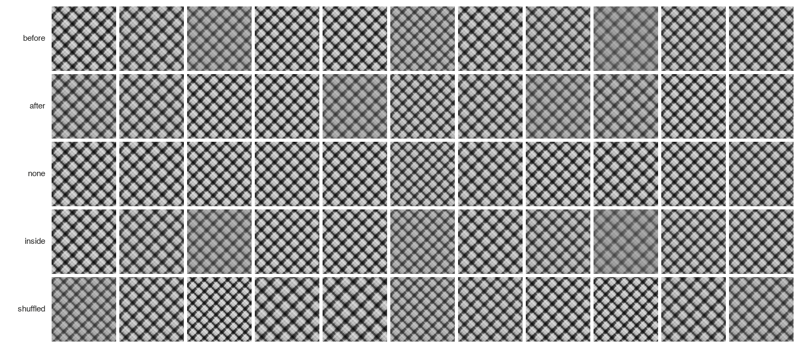
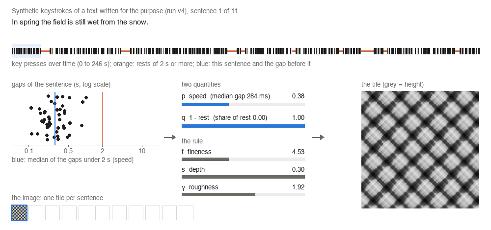
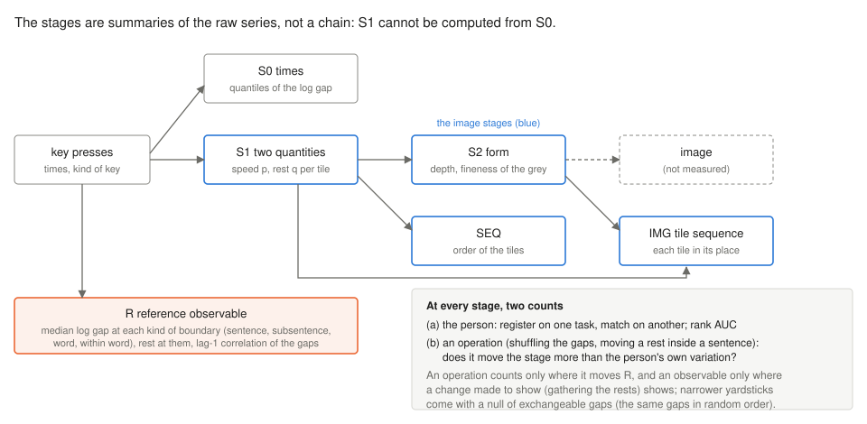

<h1 align="center">KeepCount</h1>

<p align="center">
  Conditions, code, records and git history of a stage-by-stage audit of what images of behavioral data keep,<br>
  with keystroke tiles as a worked example.
</p>

<p align="center">
  <a href="LICENSE"></a>
  <a href="LICENSE-docs"></a>
  
  <a href="https://docs.astral.sh/uv/"></a>
  
  <a href="https://doi.org/10.5281/zenodo.23858735"></a>
</p>

<p align="center"><b>English</b> | <a href="README.ja.md">日本語</a></p>

This repository is the archive of two articles by Mikoto Miura and Yuusuke Harada: *KeepCount: A Stage-by-Stage
Audit of What Images of Behavioral Data Keep, with Keystroke Tiles as a Worked Example* (preprint, not peer reviewed,
[10.5281/zenodo.23858734](https://doi.org/10.5281/zenodo.23858734); runs v1 to v6j) and, from version 1.1.0, *Can a
pause summary show where one writer paused? An audit procedure for keystroke logs* (manuscript; runs v6k to v6s), which asks the same questions of the pause summaries that writing
research reports (see [The article on pause summaries](#the-article-on-pause-summaries-version-110)).

KeepCount is an audit procedure: cut a transform from data to image into stages and, at each stage and against
comparisons fixed before the count, count (a) how well the stage tells one person from another and (b) whether an
operation on the data shows in it, with positive controls and, for a yardstick narrower than the person's own
variation, a null of exchangeable gaps. The worked example turns keystroke times into shaded tiles, one per sentence,
through two quantities, speed and rest.

<p align="center">
  
</p>
<p align="center"><sub>Synthetic keystrokes of one text written for the purpose (run v4; Fig. 3 of the preprint): one
tile per sentence when the gap before a sentence is counted in it (<b>before</b>), in the previous sentence
(<b>after</b>) or in none (<b>none</b>), after a rest is moved inside its sentence (<b>inside</b>), and with all
gaps shuffled (<b>shuffled</b>). <i>before</i> and <i>inside</i> are identical: a tile does not order its gaps.
No person's record is shown here or anywhere in this README.</sub></p>

## How keystrokes become a tile

<p align="center">
  
</p>

For a sentence, the speed *p* places the median of its gaps shorter than 2 s on a log scale between the mean
intervals of fast and slow typists, and the rest *q* is one minus the share of its time spent in gaps of 2 s or more.
A rule whose form is borrowed from a mapping of affect to tactile relief sets the fineness *f*, depth *s* and
roughness γ of a noise field from *p* and *q*, and the field is drawn as grey. The animation steps through the eleven
sentences of the text of the figure above with v4's series. The tool that makes it, `tools/readme_media.py`,
re-makes the tiles with v4's functions and stops unless *p*, *q*, the speeds and shares of rest and every pixel equal
v4's record and figure; the animation then reduces each frame to 128 colours. It is an illustration: no number of the
article comes from it.

<p align="center">
  
</p>

The stages audited (Fig. 1 of the preprint). Each is a summary of the raw series per part of a record, so a difference
between stages mixes loss with how the distance weighs the features. The reference observable R reads the kind of
boundary each gap precedes, which the image stages do not; an operation is used to judge the image only where it
moves R.

## Where each figure and table of the preprint comes from

Every computation ran a script on conditions committed to git before the script was first run; each record holds the
SHA-256 of its conditions, script and inputs and the git commit. Run `vX` has its conditions in
`works/conditions/prototype_vX.json`, its script in `works/prototype_vX.py` (with `works/_common.py` and
`src/keystroke.py`), and its record and notes in `results/prototype_vX/`.

| Preprint | Runs |
|---|---|
| Fig. 1 (the stages) | drawn by hand from Section 3; no number |
| Fig. 2 (the operations, every cell) | v6b, v6e; which cells are readable by step 4, v6f |
| Fig. 3 (the synthetic atlas) | v4 (`results/prototype_v4/seasons_sentence_external_f42.png`) |
| Table 1 (the person) | v6, v6c, v6i, v6j |
| Table 2 (the operations) | v6b, v6d, v6e |
| Table 3 (the tile sequence) | v6f, v6g, v6h |
| Table 4 (each record against its exchangeable gaps) | v6i, v6j |

The runs in order, with the commits of their conditions and records as the preprint names them (Supplement A) and as
they are in this history:

| Run | Status | What it asked | Preprint: conditions, record | Here: conditions, record |
|---|---|---|---|---|
| v1 | b | synthetic keystrokes of four texts, 30 s windows | c22cd74, 2d033fd | same |
| v2 | b | 10 s windows; regimes matched to the text's gaps | 5502d13, 80adbc2 | same |
| v3 | b | one tile per sentence | acd4f6c, 173753c | same |
| v4 | b | the atlas: where a rest falls, how the gap before a sentence is counted, seeds of the field | 4cc995d, 7afc35b | same |
| v5 | b | v4's tiles by depth and fineness | 8fe045c, 6fd5d61 | same |
| v6 | p | the first human count: the person and three operations (KUPA, 136M Keystrokes) | 06b46c2, e3a7fc3 | 06b46c2, 2296b67 |
| v6b | c | a second split and the reference R, confirmed on 200 new KUPA persons | 8bec59a, 071087b | e62dd13, afcfbbc |
| v6c | d | rank-1, rank-20 and EER; dependence on the number of persons | c0927ce, e436f43 | d5c5446, bc63d93 |
| v6d | d | R split into position and lag-1 | 1b70dbe, 17a3ddc | ac659e1, 241abae |
| v6e | c | v6b and v6d on a second dataset (LWP), with a confirmation rule fixed from KUPA | cbffc5d, 8d38d89 | aabe8ee, 6efd81e |
| v6f | d | the tile sequence and positive controls on the image stages | 3ef9868, 2abf5af | cb787a6, 72d0ed0 |
| v6g | d | a narrower yardstick: each tile redrawn from its own gaps | 652ad2e, be5f062 | 1fd4441, 34a3a39 |
| v6h | d | a null of exchangeable gaps for v6g's yardstick | 713cdf7, fabcdae | 084006e, 442365a |
| v6i | d | each record against its own exchangeable series; identification near the image | 94ceb8c, 3f1202d | 1bc3a87, 70089ac |
| v6j | d | positive controls under drift; DTW with the tiles in random order; the registration scale | d46e4b4, ab5ab80 | 3605277, 796727a |

Status, as in the preprint: **p** prespecified, **c** confirmatory, **d** decomposition on the same persons, **b** by
construction. Runs v1 to v5 use synthetic keystrokes only, made from the texts in `works/texts/` (written by the
authors). Runs v6 to v6j count three public keystroke datasets; their records hold counts and summaries over persons
(the minimum and maximum of a summary are single persons' values) and the persons' ids only as a count and a SHA-256.
References to `.steering/` in the conditions, notes, code and commit messages point to working notes that are not
archived.

## The article on pause summaries (version 1.1.0)

The second article applies the audit to summaries that writing research reports from keystroke logs: the sentence
summary without the external scale (U), the mean length of P-bursts and its spread (B, B_sd) and KLiCKe's pause means
(I), on KUPA-KEYS essays and LWP. A summary is read for one writer only where a positive control fixed in advance
reaches the same operation on the same writers. Its runs are v6k to v6s; their conditions, code and tests are in
`works/` and `tests/`, committed in the order of the working repository, conditions before code. The commits the code
ran from, as the article names them (Appendix A) and as they are here:

| Run | Article: commit | Here: commit | Conditions (SHA-256) |
|---|---|---|---|
| v6k | f940b81 | cfa00cf | febecc6c |
| v6l | 0289799 | d646fb4 | 96c9563b |
| v6m | bf5f640 | 12584ea | 43eb39e3 |
| v6n | 0c22760 | ca76249 | b10f9f12 |
| v6o | b636d51 | ab30e35 | 05d21d59 |
| v6p | b97b9db | ce2f57d | 0f328d36 |
| v6q | fa25ee6 | 8024c0c | 9a268caf |
| v6r | 3a89682 | 0bc91f6 | 4c8bfb87 |
| v6s | 1975fcd | edfcfdf | b03bc1e2 |

What is here for this article:

- `article/jowr/values/`: every value the article prints, as it prints it (`numbers.json` for the body, `fig2.tex` and
  `fig2-halves.tex`, the appendix tables `app-*.tex`), the scripts that make them from the records
  (`paper_numbers.py`, `appendix_tables.py`), and `sources.json`, which lists for each output the record cells read
  to make it (key paths, no values). The values in this archive are the article's own strings; no other value of the
  records is published (see below).
- The disclosure ledger (`ledger_inventory.py`, `ledger_classify.py`, `ledger_known_unexplained.json`): it lists
  every record value the article, its appendices and the conditions here write, with the set of writers each is
  computed on, and stops if a sum over fewer than five writers could be derived linearly from the written values
  (Appendix A). The conditions of v6l, v6m, v6o and v6q quote values of earlier records as their reasons; the ledger
  counts those quotations as written.
- `results/record-digests.json`, `tools/record_digest.py` and `tools/rebuild_records.py`: the SHA-256 of each
  original record and of its content without the provenance, and a tool that rebuilds v6k to v6s in order and stops
  unless each rebuilt record has the original content (see Reproduce).
- `docs/procedure.md`: how to run the code, how the fields of the KLiCKe corpus stand against the inputs the
  procedure needs, and how the verdicts could be counted over random two-part splits (Appendix H).
- `docs/literature.md`: which text of each cited work was read, and the searches (Appendix H).

## What is not in this archive, and why

| Left out | Why | What is here instead |
|---|---|---|
| The keystroke data (KUPA-KEYS, 136M Keystrokes, LWP) | they are kept at their sources under their own terms | their sources, paths and SHA-256 in the conditions of v6 and v6e (see Reproduce) |
| Six figures of run v6 (`results/prototype_v6/{kupa_copy,kupa_essay,aalto_session}_{tiles,scatter}.png`) | they show individual persons' records; the article publishes only counts and summaries over persons | their SHA-256 in `results/prototype_v6/record.json`; they were removed from every commit (see History) |
| The manuscript, its supplements and the scripts that write their numbers, tables and Figs. 2 and 3 | kept with the preprint; they read only the records archived here | the preprint and its supplements ([10.5281/zenodo.23858734](https://doi.org/10.5281/zenodo.23858734)) |
| The records and notes of runs v6k to v6s (`results/prototype_v6k/` to `results/prototype_v6s/`) | the article shares only the values it writes (its disclosure rule: no cell from which a sum over fewer than five writers can be derived from the shared values, Appendix A); the records hold many more values, and the notes quote them | the conditions, code and tests; the values the article writes with the record cells they come from (`article/jowr/values/`); the records' SHA-256 and content digests (`results/record-digests.json`) and the tool that rebuilds them from the public data (`tools/rebuild_records.py`). The commits that added only these records or notes are not in this history |
| The source of the second article | kept with the article | its printed values (`article/jowr/values/`) |
| The code, conditions and tests of a later, separate study (run v7 and `capture/`) | not part of these articles | none; they are not in this history |
| Working notes (`advice/`, `handoff/`, `.steering/`) | notes on the work, not inputs of any computation | none needed to run a script |

## Reproduce

Requirements: [uv](https://docs.astral.sh/uv/) and git. The tests and every run were on macOS, Apple silicon. The
generator `atact` is installed from its public repository at a pinned commit (`pyproject.toml`; archived as
[10.5281/zenodo.23681773](https://doi.org/10.5281/zenodo.23681773)).

```bash
uv sync --frozen                                 # Python 3.13 and the pinned packages of uv.lock
uv run --frozen pytest                           # 384 passed, 5 skipped; 659 passed with the records of v6k to v6s
uv run --frozen python tools/readme_media.py     # the images of this README, checked against v4's record
```

Runs v1 to v5 need nothing else. A run refuses to overwrite its results and checks that its conditions, code and
inputs equal the last commit, so move its results aside on a local branch first:

```bash
git switch -c rerun
git mv results/prototype_v4 results/prototype_v4.archived && git commit -m "move v4 aside"
uv run --frozen python works/prototype_v4.py
```

(`tools/readme_media.py` reads `results/prototype_v4/`, so it does not run on such a branch.)

In this version, v4 re-run this way gave the same record, except its provenance (the commit, and the SHA-256 of
`src/keystroke.py`, to which later runs added functions), and the same figures byte for byte (macOS, Apple silicon).

Runs v6 to v6s read the keystroke data at the paths named in their conditions and stop if a file's SHA-256 differs
(v6k to v6s read KUPA-KEYS and LWP):

| Data | Source | Terms | Path |
|---|---|---|---|
| KUPA-KEYS (Velentzas et al., LREC-COLING 2024) | https://huggingface.co/datasets/ALTACambridge/KUPA-KEYS | CC BY-NC-SA 4.0 | `external/kupa-keys/KUPA-KEYS-TASK-1.csv`, `KUPA-KEYS-TASK-2.csv` |
| 136M Keystrokes (Dhakal et al., CHI 2018) | http://userinterfaces.aalto.fi/136Mkeystrokes | non-commercial use with attribution | `external/aalto-136m/Keystrokes.zip` |
| Linking Writing Processes to Writing Quality (Kaggle, 2023) | https://www.kaggle.com/competitions/linking-writing-processes-to-writing-quality | the competition's rules | `external/kaggle-lwp/data/train_logs.csv` |

The records of v6k to v6s are rebuilt with the data in place, on a local branch:

```bash
git switch -c rebuild
uv run --frozen python tools/rebuild_records.py
```

The tool runs v6k to v6s in order and stops unless each record has the content of the original (its SHA-256 without
the provenance). A rebuilt record differs from the original file in its provenance (time, commit), so the SHA-256 that
the conditions of later runs name for it no longer matches; on the local branch the tool replaces those SHA-256 values,
and the SHA-256 of each conditions file so changed (later conditions name earlier ones), and nothing else, in the
later conditions, and commits them with the record (`docs/procedure.md`). Checked before this version was archived: from a fresh clone,
on macOS 27.0.1 (Apple silicon), uv 0.11.1 and Python 3.13.12, all nine records were rebuilt with the content of the
originals; the tests then gave 659 passed, and the scripts of `article/jowr/values/` gave all 135 values of the body
and every appendix table as the article prints them, except the table of runs (`app-runs.tex`), which prints each
record's time, commit and SHA-256.

## History and provenance

This history was prepared from the working repository in which the computations were run by removing the six figures
of run v6 from every commit; the dates, the order, the messages and the author are unchanged. The commits after the
first removed figure therefore differ from those named in the articles and in the records; `commit-map.tsv` maps each
original commit to the one here. The commits after the last mapped one add the README, the licences and the map
(version 1.0.0) and, in version 1.0.1, the images of this README, the tool that makes them, the Japanese README and
`CITATION.cff`.

Version 1.1.0 continues the history after v6j with the commits of the working repository that hold the conditions,
code and tests of v6k to v6s and a fix of the earlier scripts' temporary files, made the same way (same dates,
messages and author) and placed after the commits of version 1.0.1. The commits that added only the records or notes
of v6k to v6s, and those of the later study, are left out. `commit-map.tsv` maps these commits too; the last two
commits add the files of this version and its DOI.

Versions: 1.0.0 ([10.5281/zenodo.23858736](https://doi.org/10.5281/zenodo.23858736)), which the preprint of the first article cites; 1.0.1
([10.5281/zenodo.23862942](https://doi.org/10.5281/zenodo.23862942)), which adds only the images of the README and their tool, `README.ja.md` and `CITATION.cff`, and rewrites this README.
1.1.0 ([10.5281/zenodo.24095177](https://doi.org/10.5281/zenodo.24095177)), which adds the conditions, code and tests of v6k to v6s and the files of the second article, and which the second
article cites.
[10.5281/zenodo.23858735](https://doi.org/10.5281/zenodo.23858735) resolves to the latest version.

## Citation

Please cite the article you use and this archive (also in `CITATION.cff`):

> Miura, M. and Harada, Y. Can a pause summary show where one writer paused? An audit procedure for keystroke logs.
> Manuscript, 2026.

> Miura, M. and Harada, Y. KeepCount: A Stage-by-Stage Audit of What Images of Behavioral Data Keep, with Keystroke
> Tiles as a Worked Example. Preprint, Zenodo, 2026. https://doi.org/10.5281/zenodo.23858734

> Miura, M. and Harada, Y. (2026). KeepCount: conditions, code, records and history. Zenodo.
> https://doi.org/10.5281/zenodo.23858735

This DOI resolves to the latest version. To cite the version an article used, cite its own DOI from the list of
versions under History and provenance: 1.0.0 for the preprint of the first article, 1.1.0 for the second article.

The form of the rule comes from the preprint of the second author:

> Harada, Y. (2026). Affective Tactility: Cross-Modal Translation from Natural Language to Procedural Height Maps.
> Preprint, Research Square. https://doi.org/10.21203/rs.3.rs-8696852/v1

## License

The code is released under the MIT License (`LICENSE`). From version 1.1.1, the documents, conditions, texts and
images, and the results of runs v1 to v5 (synthetic keystrokes only), are released under CC BY 4.0. The results of runs
v6 to v6j and the values of `article/jowr/values/` count keystroke data of others and keep the terms of their sources.
`REUSE.toml` states the licence of every file, `LICENSES/` holds the texts and `LICENSE-docs` summarizes them.
Versions 1.0.0 to 1.1.0 were released with the documents under CC BY-NC-SA 4.0 and keep that licence.

## Authors

- Mikoto Miura, Independent Researcher ([ORCID 0009-0000-4196-0508](https://orcid.org/0009-0000-4196-0508))
- Yuusuke Harada, Graduate School of Humanities and Social Sciences, Hiroshima University, Japan
  ([ORCID 0009-0006-7252-5115](https://orcid.org/0009-0006-7252-5115))
